<div align="center">
  
</div>

<p align="center">
  <a href="https://github.com/ratan1501"></a>
  <a href="https://linkedin.com/in/ratan-deep-mishra-03065b27a"></a>
  
</p>


<div align="center">
  
</div>


<div align="center">
  
</div>


## `// featured_projects`

| Project | What it does | Stack |
|:--|:--|:--|
| **[project-one](https://github.com/ratan1501/project-one)** | One line on the problem it solves | `React` `Node.js` `MongoDB` |
| **[project-two](https://github.com/ratan1501/project-two)** | One line on the problem it solves | `TypeScript` `Express` `SQL` |
| **[portfolio](https://github.com/ratan1501)** | My personal dev portfolio | `React` `Vite` `Tailwind` |


## `// currently`

```diff
+ shipping a personal portfolio site
+ grinding DSA + system design
+ exploring AI/ML ahead of my MCA (AIML)
- tutorial hell
```


<div align="center">
  
</div>
